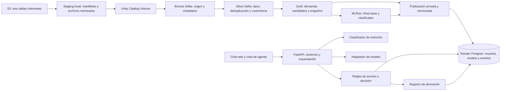

# 02 — Arquitectura, seguridad y operación

Estado: diseño; ningún componente está implementado.

## Flujo de datos, ML y servicio

Databricks Free Edition es la plataforma de preparación, análisis y entrenamiento; no está en la ruta de cada solicitud del cliente. Sus notebooks, jobs, Lakeflow y MLflow cubren el flujo previsto con una pipeline activa y un job de entrenamiento. La edición gratuita tiene cuotas diarias, un máximo de cinco tareas de job simultáneas y acceso saliente restringido; por eso la carga parte de archivos preparados localmente y la demo no depende de su disponibilidad. [Funciones de Free Edition](https://docs.databricks.com/aws/en/getting-started/free-edition), [límites](https://docs.databricks.com/aws/en/getting-started/free-edition-limitations).

Una sola aplicación FastAPI sirve la web y la API en Render. Postgres conserva el snapshot autorizado, el artefacto de clasificador con versión y hash, cuentas de prueba, sesiones, conversaciones, eventos de auditoría y derivaciones. La web consulta únicamente la API del mismo origen. El servicio no necesita claves S3 ni credenciales de Databricks.

### Ciclo del pipeline

1. Un proceso local enumera los objetos de S3, crea un manifiesto con ruta, partición, tamaño y SHA-256, y agrupa los CSV diarios por mes en archivos Parquet con columnas de linaje. No cambia los originales.
2. Los archivos mensuales se cargan a un volumen administrado de Unity Catalog. Una pipeline Lakeflow crea bronze, silver y gold en Delta. Unity Catalog registra linaje de las transformaciones; se conserva además el manifiesto para rastrear hasta el objeto original. [Carga en volúmenes](https://docs.databricks.com/aws/en/volumes/volume-files), [linaje](https://docs.databricks.com/aws/en/data-governance/unity-catalog/data-lineage).
3. Silver valida tipos, claves, relaciones y estados; separa registros dudosos en cuarentena. Gold materializa demanda mensual, candidatos de intención y un snapshot apto para consulta. El módulo ML posee las anotaciones y las une a los candidatos, sin modificar las tablas de A.
4. El job de ML registra línea base, modelo, umbral y métricas en MLflow. Solo el artefacto aprobado y la muestra gold seleccionada se publican de forma privada en Postgres; Render carga una versión fija al iniciar. Si no hay versión válida, el asistente se abstiene.
5. Una nueva partición o una llegada tardía se vuelve a procesar por manifiesto. Una carga repetida produce las mismas claves y conteos; antes de activar una versión se comparan controles de calidad y se conserva la anterior para recuperación.

## Secuencia de una consulta

1. La API valida la cookie de sesión y obtiene el `customer_id` o el rol de agente desde la base; ignora cualquier identidad incluida en el mensaje del chat.
2. El clasificador propone intención y confianza. La orquestación usa el contexto de conversación para pedir aclaración cuando falte una referencia o exista más de una coincidencia.
3. La capa de datos filtra productos y transacciones por el cliente autorizado antes de devolver hechos tipados. No entrega columnas internas como `is_fraud` o `fraud_score` al modelo ni al cliente.
4. Las reglas deterministas fijan los resultados permitidos: responder, aclarar, abstenerse o derivar. El modelo redacta en el idioma del usuario con campos permitidos y una salida validada; no ejecuta SQL ni acciones bancarias.
5. Si hay derivación, la API guarda el caso y solo después confirma su creación. El paquete para agente contiene evidencia verificable, decisión y preguntas pendientes; no incluye razonamiento interno del modelo.

## Seguridad y datos

- Cuentas de prueba con contraseñas almacenadas mediante Argon2id. Sesión aleatoria del servidor en cookie `HttpOnly`, `Secure`, `SameSite=Lax`, con caducidad por inactividad de 30 minutos y absoluta de 8 horas. Las solicitudes mutables del navegador usan token CSRF.
- Dos roles: `customer` y `agent`. Cada consulta de transacciones comprueba pertenencia en SQL; las derivaciones solo son visibles para agentes. La cuenta de cliente no puede elegir otro `customer_id`.
- Claves de modelo y base en secretos de Render. Ninguna clave S3 en Render, Databricks o Git: la estación de staging obtiene datos por acceso de solo lectura y sube archivos preparados. La muestra se publica de forma privada tras revisar los términos concretos de los servicios usados.
- Minimización: al modelo se envían intención, idioma y hechos estrictamente necesarios, sin documento nacional, datos de contacto, número completo de producto ni registros de otros clientes. No se registran prompts con datos personales en logs operativos.
- El histórico del dataset llega hasta junio de 2026 según la documentación. Toda respuesta factual indica fecha de corte y evita afirmar disponibilidad o estado actual.
- Datos de transacciones y texto recuperado se tratan como no confiables para instrucciones. Los campos recuperados no pueden cambiar políticas, roles o herramientas disponibles.

## Fallos y observabilidad

- Timeout acotado del modelo; un reintento solo para errores transitorios y solo en operaciones idempotentes. Si falla, respuesta determinista de abstención o derivación sin inventar contenido.
- Caída de Postgres: no responder con hechos ni anunciar derivación creada. La UI informa indisponibilidad temporal.
- Trazas con `trace_id`, versión de modelo/prompt/clasificador, decisiones de regla, referencias de evidencia, duración, consumo y resultado de herramientas. Los logs excluyen texto sensible y secretos.
- Métricas: intentos, resoluciones seguras verificadas offline, derivaciones, errores de autorización, fallos de herramientas, latencia p50/p95 y costo estimado. No se presenta la evaluación offline como resultado de producción.
- Actualización de la muestra mediante carga repetible y controlada; deduplicar por claves, verificar integridad y registrar versión y corte. El dataset es histórico y estático, por lo que el procesamiento por lotes es suficiente; la corrección incremental se demostrará con una partición tardía creada como fixture.

## Límites de producción

El prototipo usa cuentas de prueba, muestra histórica y herramientas simuladas. Antes de operar un banco real harían falta identidad corporativa, integración transaccional de solo lectura, políticas aprobadas, revisión legal, retención formal, gestión de incidentes, controles de capacidad, pruebas de carga y monitoreo continuo.
