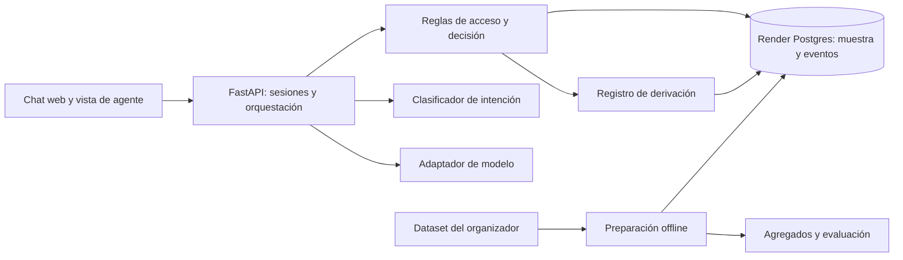

# 02 — Arquitectura, seguridad y operación

Estado: diseño; ningún componente está implementado.

## Componentes y flujo

Una sola aplicación FastAPI sirve la web y la API en Render. Postgres conserva la muestra autorizada, cuentas de prueba, sesiones, conversaciones, eventos de auditoría y derivaciones. La preparación y la evaluación se ejecutan fuera del servicio web; el servicio no necesita claves S3. La web consulta únicamente la API del mismo origen.

## Secuencia de una consulta

1. La API valida la cookie de sesión y obtiene el `customer_id` o el rol de agente desde la base; ignora cualquier identidad incluida en el mensaje del chat.
2. El clasificador propone intención y confianza. La orquestación usa el contexto de conversación para pedir aclaración cuando falte una referencia o exista más de una coincidencia.
3. La capa de datos filtra productos y transacciones por el cliente autorizado antes de devolver hechos tipados. No entrega columnas internas como `is_fraud` o `fraud_score` al modelo ni al cliente.
4. Las reglas deterministas fijan los resultados permitidos: responder, aclarar, abstenerse o derivar. El modelo redacta en el idioma del usuario con campos permitidos y una salida validada; no ejecuta SQL ni acciones bancarias.
5. Si hay derivación, la API guarda el caso y solo después confirma su creación. El paquete para agente contiene evidencia verificable, decisión y preguntas pendientes; no incluye razonamiento interno del modelo.

## Seguridad y datos

- Cuentas de prueba con contraseñas almacenadas mediante Argon2id. Sesión aleatoria del servidor en cookie `HttpOnly`, `Secure`, `SameSite=Lax`, con caducidad por inactividad de 30 minutos y absoluta de 8 horas. Las solicitudes mutables del navegador usan token CSRF.
- Dos roles: `customer` y `agent`. Cada consulta de transacciones comprueba pertenencia en SQL; las derivaciones solo son visibles para agentes. La cuenta de cliente no puede elegir otro `customer_id`.
- Claves de modelo y base en secretos de Render. Ninguna clave S3 en Render ni en Git. La muestra se carga de forma privada solo si los términos de uso lo permiten.
- Minimización: al modelo se envían intención, idioma y hechos estrictamente necesarios, sin documento nacional, datos de contacto, número completo de producto ni registros de otros clientes. No se registran prompts con datos personales en logs operativos.
- El histórico del dataset llega hasta junio de 2026 según la documentación. Toda respuesta factual indica fecha de corte y evita afirmar disponibilidad o estado actual.
- Datos de transacciones y texto recuperado se tratan como no confiables para instrucciones. Los campos recuperados no pueden cambiar políticas, roles o herramientas disponibles.

## Fallos y observabilidad

- Timeout acotado del modelo; un reintento solo para errores transitorios y solo en operaciones idempotentes. Si falla, respuesta determinista de abstención o derivación sin inventar contenido.
- Caída de Postgres: no responder con hechos ni anunciar derivación creada. La UI informa indisponibilidad temporal.
- Trazas con `trace_id`, versión de modelo/prompt/clasificador, decisiones de regla, referencias de evidencia, duración, consumo y resultado de herramientas. Los logs excluyen texto sensible y secretos.
- Métricas: intentos, resoluciones seguras verificadas offline, derivaciones, errores de autorización, fallos de herramientas, latencia p50/p95 y costo estimado. No se presenta la evaluación offline como resultado de producción.
- Actualización de la muestra mediante carga repetible y controlada; deduplicar por claves, verificar integridad y registrar versión y corte. No se requiere streaming para la demo.

## Límites de producción

El prototipo usa cuentas de prueba, muestra histórica y herramientas simuladas. Antes de operar un banco real harían falta identidad corporativa, integración transaccional de solo lectura, políticas aprobadas, revisión legal, retención formal, gestión de incidentes, controles de capacidad, pruebas de carga y monitoreo continuo.
